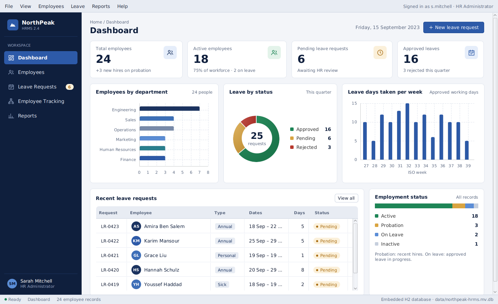

# NorthPeak HRMS

Desktop **Human Resources Management System** built with **Java 17** and **JavaFX 17**.
HR administrators manage employee records, track employment status and process leave requests.
Data is stored in an embedded **H2** database through **JDBC** (no database server to install).



## Features

| Module | What it does |
|---|---|
| **Admin dashboard** | Total and active employees, pending and approved leaves, employees by department, leave by status, leave days per week, recent requests, employment status |
| **Employee management** | Searchable directory (name, ID, department, job title, email), filters by department and status, add / edit / view / delete with validation |
| **Employee profile** | Employment details, manager, tenure, contact information, annual leave balance (allowance, used, pending, remaining) and leave history |
| **Leave management** | Submit requests with a live working-day count and balance check, Pending / Approved / Rejected / All tabs, approve or reject with a reason |
| **Employee tracking** | Department → job title tree, status filter, search |
| **Reports** | Average tenure, approval rate, approved leave days, hires by year, leave days by type, department summary |

## Tech stack

- Java 17 (LTS)
- JavaFX 17 (`javafx-controls`), styled with CSS
- H2 2.2 embedded database, plain JDBC (DAO pattern)
- Maven
- JUnit 5

## Project structure

```
src/main/java/com/northpeak/hrms
├── App.java / Launcher.java      # JavaFX entry point, main class for the runnable jar
├── model/                        # Employee, LeaveRequest, LeaveBalance, enums
├── db/                           # Database (schema), EmployeeDao, LeaveRequestDao, DemoData
├── service/                      # HrService (business rules), AppClock, ValidationException
└── ui/
    ├── MainWindow.java           # menu bar, sidebar, status bar, toasts, navigation
    ├── Ui.java / Dialogs.java    # shared UI components
    ├── views/                    # Dashboard, Employees, EmployeeDetail, Leave, Tracking, Reports
    └── dialogs/                  # EmployeeDialog, LeaveRequestDialog
src/main/resources/css/styles.css # navy / white / light-gray theme
src/test/java/...                 # HrServiceTest (JUnit 5, in-memory H2)
```

## Run

Requirements: **JDK 17+** and **Maven 3.8+**.

```bash
mvn clean javafx:run
```

Build a runnable jar (for the operating system you build on):

```bash
mvn clean package
java -jar target/northpeak-hrms-1.0.0-all.jar
```

Run the tests:

```bash
mvn test
```

On first start the application creates `data/northpeak-hrms.mv.db` and loads the demo dataset.
Use **File → Reset demo data** to restore it.

## Demo data and date

All data is fictional: 24 employees and 25 leave requests between **July and September 2023**.
The application date is set to **15 September 2023** so the demo is consistent.
To use the real system date, run the jar with:

```bash
java -Dhrms.today=now -jar target/northpeak-hrms-1.0.0-all.jar
```

## Business rules

- Annual allowance: 25 working days per year; sick allowance: 10 days.
- Leave is counted in working days (Monday–Friday).
- An annual-leave request cannot exceed the remaining balance minus pending requests.
- Approving a request that covers today sets the employee to **On Leave**.
- Deleting an employee also deletes their leave history (`ON DELETE CASCADE`).

## Author

Nour El Houda Lassoued — Full Stack Developer
